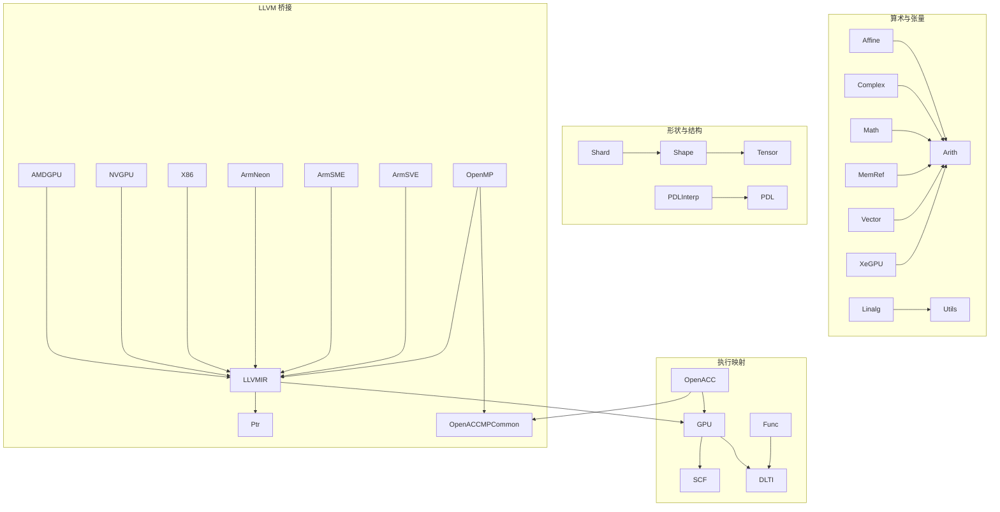

# 11 `.td` 依赖图（图形版）

本章把 412 个节点、1132 条 include 边画成分层图。为了可读性，图被拆成四张：

1. 概念六层金字塔（骨架）；
2. IR 内核 30 个文件的真实 include 图；
3. 48 个方言之间的 21 条核心依赖边；
4. `TransformOps` 扩展层 23 个扩展的汇聚关系，以及最长 include 链。

全部图形由扫描结果直接生成，可用任意 Mermaid 渲染器查看。

- 分析基线：`research/mlir` / `53a80edfeb2e`（基于 `5f7f36636abe`）。
- 图例：`A --> B` 读作“A include B”，即“A 依赖 B”。

## 1. 概念分层骨架

```
T6 扩展 / 绑定    python 60 · TransformOps 17+6 · pattern 5 · Passes.td 38 · ...   81
      │
T5 具体方言       Dialect/<X>/**  277 个文件 · 48 个 def ... : Dialect
      │
      ├── T4 通用接口   mlir/Interfaces 下的跨方言契约                    27
      ├── T3 Builtin    Builtin*.td + bytecode 相关文件                    9
      └── 横向复用       21 条“方言 → 方言”边（见 §3）
      │
T2 op/attr 骨架   OpBase · AttrTypeBase · Interfaces · EnumAttr · ...          11
      │
T1 约束骨架       Constraints · Traits · Common*Constraints · ...              6
      │
T0 基础           Utils.td（CPred 组合子）                                     1
```


箭头方向是“依赖”：越往下越基础，越往上越专用。412 个文件里 366 个（88.8%）
传递依赖最底层的 `Utils.td`。

## 2. IR 内核：30 个文件的真实 include 图

范围：`mlir/IR/*.td`（27）+ `mlir/Pass/PassBase.td` + `mlir/Bytecode/*.td`（2）。
这是整张图唯一有“深度”的部分。

```mermaid
graph TD
  IR_Utils["IR/Utils.td"]
  IR_Constraints["IR/Constraints.td"]
  IR_DialectBase["IR/DialectBase.td"]
  IR_Traits["IR/Traits.td"]
  IR_CommonTypeConstraints["IR/CommonTypeConstraints.td"]
  IR_CommonAttrConstraints["IR/CommonAttrConstraints.td"]
  IR_Properties["IR/Properties.td"]
  IR_AttrTypeBase["IR/AttrTypeBase.td"]
  IR_Interfaces["IR/Interfaces.td"]
  IR_OpBase["IR/OpBase.td"]
  Bytecode_BytecodeDialectInterface["Bytecode/BytecodeDialectInterface.td"]
  Bytecode_BytecodeOpInterface["Bytecode/BytecodeOpInterface.td"]
  IR_BuiltinAttributeInterfaces["IR/BuiltinAttributeInterfaces.td"]
  IR_BuiltinAttributes["IR/BuiltinAttributes.td"]
  IR_BuiltinDialect["IR/BuiltinDialect.td"]
  IR_BuiltinDialectBytecode["IR/BuiltinDialectBytecode.td"]
  IR_BuiltinLocationAttributes["IR/BuiltinLocationAttributes.td"]
  IR_BuiltinOps["IR/BuiltinOps.td"]
  IR_BuiltinTypeInterfaces["IR/BuiltinTypeInterfaces.td"]
  IR_BuiltinTypes["IR/BuiltinTypes.td"]
  IR_BytecodeBase["IR/BytecodeBase.td"]
  IR_EnumAttr["IR/EnumAttr.td"]
  IR_OpAsmDialectInterface["IR/OpAsmDialectInterface.td"]
  IR_OpAsmInterface["IR/OpAsmInterface.td"]
  IR_PatternBase["IR/PatternBase.td"]
  IR_QuantStorageTypeInterface["IR/QuantStorageTypeInterface.td"]
  IR_RegionKindInterface["IR/RegionKindInterface.td"]
  IR_SymbolInterfaces["IR/SymbolInterfaces.td"]
  IR_TensorEncoding["IR/TensorEncoding.td"]
  Pass_PassBase["Pass/PassBase.td"]
  IR_Constraints --> IR_Utils
  IR_DialectBase --> IR_Utils
  IR_Traits --> IR_Constraints
  IR_CommonTypeConstraints --> IR_Constraints
  IR_CommonTypeConstraints --> IR_DialectBase
  IR_CommonAttrConstraints --> IR_CommonTypeConstraints
  IR_CommonAttrConstraints --> IR_Constraints
  IR_CommonAttrConstraints --> IR_DialectBase
  IR_Properties --> IR_Constraints
  IR_Properties --> IR_Utils
  IR_AttrTypeBase --> IR_CommonAttrConstraints
  IR_AttrTypeBase --> IR_CommonTypeConstraints
  IR_AttrTypeBase --> IR_Constraints
  IR_AttrTypeBase --> IR_DialectBase
  IR_AttrTypeBase --> IR_Traits
  IR_Interfaces --> IR_AttrTypeBase
  IR_Interfaces --> IR_Constraints
  IR_Interfaces --> IR_Traits
  IR_OpBase --> IR_AttrTypeBase
  IR_OpBase --> IR_Constraints
  IR_OpBase --> IR_DialectBase
  IR_OpBase --> IR_Interfaces
  IR_OpBase --> IR_Properties
  IR_OpBase --> IR_Traits
  IR_OpBase --> IR_Utils
  Bytecode_BytecodeDialectInterface --> IR_Interfaces
  Bytecode_BytecodeOpInterface --> IR_OpBase
  IR_BuiltinAttributeInterfaces --> IR_OpBase
  IR_BuiltinAttributes --> IR_AttrTypeBase
  IR_BuiltinAttributes --> IR_BuiltinAttributeInterfaces
  IR_BuiltinAttributes --> IR_BuiltinDialect
  IR_BuiltinAttributes --> IR_OpAsmInterface
  IR_BuiltinDialect --> IR_OpBase
  IR_BuiltinDialectBytecode --> IR_BytecodeBase
  IR_BuiltinLocationAttributes --> IR_AttrTypeBase
  IR_BuiltinLocationAttributes --> IR_BuiltinDialect
  IR_BuiltinOps --> IR_BuiltinDialect
  IR_BuiltinOps --> IR_OpAsmInterface
  IR_BuiltinOps --> IR_RegionKindInterface
  IR_BuiltinOps --> IR_SymbolInterfaces
  IR_BuiltinTypeInterfaces --> IR_OpBase
  IR_BuiltinTypes --> IR_AttrTypeBase
  IR_BuiltinTypes --> IR_BuiltinDialect
  IR_BuiltinTypes --> IR_BuiltinTypeInterfaces
  IR_BuiltinTypes --> IR_CommonTypeConstraints
  IR_BuiltinTypes --> IR_QuantStorageTypeInterface
  IR_EnumAttr --> IR_AttrTypeBase
  IR_EnumAttr --> IR_Properties
  IR_OpAsmDialectInterface --> IR_Interfaces
  IR_OpAsmInterface --> IR_AttrTypeBase
  IR_OpAsmInterface --> IR_OpBase
  IR_PatternBase --> IR_OpBase
  IR_QuantStorageTypeInterface --> IR_OpBase
  IR_RegionKindInterface --> IR_OpBase
  IR_SymbolInterfaces --> IR_OpBase
  IR_TensorEncoding --> IR_OpBase
```



读图要点：

- **唯一的主干**：`Utils → Constraints → CommonTypeConstraints → CommonAttrConstraints →
  AttrTypeBase → Interfaces → OpBase`，7 层，任一环都不存在。
- **`OpBase.td` 是“总线”**：入度 127，出度 7（把 T0–T2 全部重新导出）。
  方言文件写一行 `include "mlir/IR/OpBase.td"` 就拿到 `Op`/`AttrDef`/`TypeDef`/`Trait`。
- **Builtin 是普通方言**：`BuiltinOps.td`/`BuiltinTypes.td` 和外部方言走同一套路径，
  没有特殊入口。`Builtin/` 这组里唯一与 op/attr 无关的分支是
  `BuiltinDialectBytecode.td → BytecodeBase.td`（bytecode 生成）。
- **`PassBase.td` 完全孤立**（无 include、无被 include 于本子图），
  这是 pass 定义与 op 定义解耦的结构证据。

### 2.1 `mlir/Interfaces` 的依赖目标（27 个文件）

| 文件 | include 目标 |
| --- | --- |
| `AlignmentAttrInterface.td` | `OpBase.td` |
| `CallInterfaces.td` | `OpBase.td` |
| `CastInterfaces.td` | `OpBase.td` |
| `ControlFlowInterfaces.td` | `OpBase.td` |
| `DataLayoutInterfaces.td` | `OpBase.td` |
| `DerivedAttributeOpInterface.td` | `OpBase.td` |
| `DestinationStyleOpInterface.td` | `OpBase.td` |
| `DialectFoldInterface.td` | `Interfaces.td` |
| `FunctionInterfaces.td` | `SymbolInterfaces.td`, `CallInterfaces.td` |
| `IndexingMapOpInterface.td` | `OpBase.td` |
| `InferIntDivisibilityOpInterface.td` | `OpBase.td` |
| `InferIntRangeInterface.td` | `OpBase.td` |
| `InferStridedMetadataInterface.td` | `OpBase.td` |
| `InferTypeOpInterface.td` | `OpBase.td` |
| `LoopLikeInterface.td` | `OpBase.td` |
| `MemOpInterfaces.td` | `OpBase.td` |
| `MemorySlotInterfaces.td` | `OpBase.td` |
| `ParallelCombiningOpInterface.td` | `OpBase.td` |
| `RuntimeVerifiableOpInterface.td` | `OpBase.td` |
| `ShapedOpInterfaces.td` | `OpBase.td` |
| `SideEffectInterfaceBase.td` | `OpBase.td` |
| `SideEffectInterfaces.td` | `SideEffectInterfaceBase.td` |
| `SubsetOpInterface.td` | `OpBase.td` |
| `TilingInterface.td` | `OpBase.td` |
| `ValueBoundsOpInterface.td` | `OpBase.td` |
| `VectorInterfaces.td` | `OpBase.td` |
| `ViewLikeInterface.td` | `OpBase.td` |

24/27 只依赖 `OpBase.td`，所以接口层在图上是一颗“星”，不是一条链。
`SideEffectInterfaces.td → SideEffectInterfaceBase.td` 的拆分是为了让
`SideEffectInterfaceBase` 可被 `mlir/IR` 内部复用而不引入完整 trait。

## 3. 方言之间的依赖：21 条边

把 `Dialect/<X>` 聚合成节点、只保留“方言 → 方言”的边（去掉所有指向
`IR`/`Interfaces`/`Pass` 的公共依赖），得到的是这张很扁的图：



注意 `OpenACC` 同时出现在两个 subgraph 里（Mermaid 会取第一次出现的位置），
它的两条边仍然有效：`OpenACC → GPU`、`OpenACC → OpenACCMPCommon`。

这张图的 5 个事实：

| 事实 | 证据 |
| --- | --- |
| 方言层几乎平坦 | 48 个方言只有 21 条边，平均出度 0.44 |
| 最长链 4 跳 | `AMDGPU → LLVMIR → GPU → DLTI`（`DLTI` 无方言依赖） |
| `LLVMIR` 是最大枢纽 | 入度 7（AMDGPU/NVGPU/X86/ArmNeon/ArmSME/ArmSVE/OpenMP） |
| `Arith` 是第二枢纽 | 入度 6（Affine/Complex/Math/MemRef/Vector/XeGPU） |
| 存在“回指” | `LLVMIR → GPU`（`NVVMOps.td`/`ROCDLOps.td`/`XeVMOps.td` include `GPU/IR/CompilationAttrInterfaces.td`），所以 LLVM 系并非纯上层 |

`LLVMIR → GPU` 这条边值得单独记：它的成因是 GPU 定义了
`OffloadingLLVMTranslationAttrInterface` 等“编译属性接口”，LLVM 方言的
NVVM/ROCDL/XeVM 子方言要复用这些接口。**接口放在 GPU，实现落在 LLVMIR**，
是 MLIR 里少见的反向依赖。

## 4. `TransformOps`：23 个扩展全部汇聚到一个点

`mlir/include/mlir/Dialect/*/TransformOps/*.td` 是各方言为 transform 方言提供的扩展 op。
它们只依赖 `Dialect/Transform`，而方言核心不依赖它们：

```mermaid
graph TD
  subgraph Ext["mlir/include/mlir/Dialect/*/TransformOps"]
    ExtAffine["Affine"]
    ExtArmNeon["ArmNeon"]
    ExtArmSVE["ArmSVE"]
    ExtBufferization["Bufferization"]
    ExtDLTI["DLTI"]
    ExtFunc["Func"]
    ExtGPU["GPU"]
    ExtLinalg["Linalg"]
    ExtMath["Math"]
    ExtMemRef["MemRef"]
    ExtNVGPU["NVGPU"]
    ExtSCF["SCF"]
    ExtSparseTensor["SparseTensor"]
    ExtTensor["Tensor"]
    ExtVector["Vector"]
    ExtX86["X86"]
    ExtXeGPU["XeGPU"]
  end
  TransformDialect["Dialect/Transform<br/>TransformDialect.td<br/>TransformTypes.td"]
  ExtAffine --> TransformDialect
  ExtArmNeon --> TransformDialect
  ExtArmSVE --> TransformDialect
  ExtBufferization --> TransformDialect
  ExtDLTI --> TransformDialect
  ExtFunc --> TransformDialect
  ExtGPU --> TransformDialect
  ExtLinalg --> TransformDialect
  ExtMath --> TransformDialect
  ExtMemRef --> TransformDialect
  ExtNVGPU --> TransformDialect
  ExtSCF --> TransformDialect
  ExtSparseTensor --> TransformDialect
  ExtTensor --> TransformDialect
  ExtVector --> TransformDialect
  ExtX86 --> TransformDialect
  ExtXeGPU --> TransformDialect
```



图上是 17 个方言的 `TransformOps/` 目录。此外 `mlir/include/mlir/Dialect/Transform/`
下还有 6 个 extension 目录（`DebugExtension`、`IRDLExtension`、`LoopExtension`、
`PDLExtension`、`SMTExtension`、`TuneExtension`），它们也 include `TransformDialect.td`，
合计 23 个扩展全部汇聚到同一个 dialect 定义。

除了指向 `Transform`，还有 4 条边指向本方言（或 SCF）的具体定义：

| 源文件 | 目标 | 原因 |
| --- | --- | --- |
| `Bufferization/TransformOps/BufferizationTransformOps.td` | `Bufferization/IR/BufferizationEnums.td` | 需要枚举 |
| `Linalg/TransformOps/LinalgTransformOps.td` | `Linalg/IR/LinalgEnums.td` | 需要枚举 |
| `Linalg/TransformOps/LinalgTransformOps.td` | `SCF/IR/DeviceMappingInterface.td` | op 的 attr 约束复用 SCF 接口 |
| `Vector/TransformOps/VectorTransformOps.td` | `Vector/Transforms/VectorTransformsBase.td` | 需要 `VectorTransposeLowering` 枚举 |

它们都指向**类型/枚举/接口定义**，而不是 op 定义；因此不会把“方言核心依赖 transform”
这条边反向建立起来。

## 5. 最长 include 链（16 跳）

```
python/mlir/dialects/AMDGPUOps.td
  → Dialect/AMDGPU/IR/AMDGPU.td
    → Dialect/AMDGPU/IR/AMDGPUOps.td
      → Dialect/AMDGPU/IR/AMDGPUAttrs.td
        → Dialect/LLVMIR/ROCDLAttrs.td
          → Dialect/LLVMIR/ROCDLDialect.td
            → Dialect/LLVMIR/LLVMOpBase.td
              → Dialect/LLVMIR/LLVMAttrDefs.td
                → Dialect/LLVMIR/LLVMInterfaces.td
                  → Interfaces/DataLayoutInterfaces.td
                    → IR/OpBase.td
                      → IR/Interfaces.td
                        → IR/AttrTypeBase.td
                          → IR/CommonAttrConstraints.td
                            → IR/CommonTypeConstraints.td
                              → IR/Constraints.td
                                → IR/Utils.td
```

这条链是“方言复用”的极端样本：AMDGPU 的 attr 定义在 ROCDL 上，
ROCDL 是 LLVM 方言的子集，LLVM 方言要用 `DataLayoutInterfaces`，
最后落到 IR 内核。它也解释了为什么深度分布有 16 这一档——
**跨方言属性复用会把两条 9 层的链首尾相接**。


## 6. 度数排行

### 6.1 直接入度（有多少文件直接 include 它）

| 文件 | 入度 |
| --- | --- |
| `mlir/IR/OpBase.td` | 127 |
| `mlir/Interfaces/SideEffectInterfaces.td` | 92 |
| `mlir/IR/EnumAttr.td` | 49 |
| `mlir/IR/AttrTypeBase.td` | 43 |
| `mlir/Interfaces/InferTypeOpInterface.td` | 40 |
| `mlir/Pass/PassBase.td` | 39 |
| `mlir/Dialect/Transform/IR/TransformDialect.td` | 27 |
| `mlir/IR/OpAsmInterface.td` | 27 |
| `mlir/Dialect/Transform/Interfaces/TransformInterfaces.td` | 25 |
| `mlir/Interfaces/ControlFlowInterfaces.td` | 24 |
| `mlir/IR/SymbolInterfaces.td` | 23 |
| `mlir/Dialect/SPIRV/IR/SPIRVBase.td` | 23 |

### 6.2 传递依赖者（有多少文件最终依赖它）

| 文件 | 传递依赖者 | 占比 |
| --- | --- | --- |
| `mlir/IR/Utils.td` | 366 | 88.8% |
| `mlir/IR/DialectBase.td` | 361 | 87.6% |
| `mlir/IR/Constraints.td` | 358 | 86.9% |
| `mlir/IR/CommonTypeConstraints.td` | 354 | 85.9% |
| `mlir/IR/CommonAttrConstraints.td` | 353 | 85.7% |
| `mlir/IR/Traits.td` | 353 | 85.7% |
| `mlir/IR/AttrTypeBase.td` | 352 | 85.4% |
| `mlir/IR/Properties.td` | 338 | 82.0% |
| `mlir/IR/Interfaces.td` | 330 | 80.1% |
| `mlir/IR/OpBase.td` | 320 | 77.7% |
| `mlir/IR/EnumAttr.td` | 170 | 41.3% |
| `mlir/Interfaces/SideEffectInterfaceBase.td` | 170 | 41.3% |
| `mlir/Interfaces/SideEffectInterfaces.td` | 169 | 41.0% |

`OpBase.td` 的传递依赖者（320）少于 `Utils.td`（366）：全图有 92 个文件不经过 `OpBase`。
其中 37 个是 `Passes.td`（只要 `PassBase.td`），26 个是方言的 `*Enums.td`/`*Dialect.td`/
`*Bytecode.td`（只要 `DialectBase.td` 或 `BytecodeBase.td`），14 个是 `mlir/IR` 内部
（`OpBase` 自身及其下游），其余是 python 绑定、`Target`/`Conversion` 的 dialect interface。
也就是说：“定义一个方言”和“定义方言里的 op”走的是两条不同深度的路径。

## 7. 深度分布再解读

```
depth :  0   1   2   3  4  5   6   7   8   9  10  11  12 13 14 15 16
count :  8  38  12   1  1  5  23  87  43  94  56  22  13  5  2  1  1
```

- `d=0`(8)：真正没有 include 的文件，全部是“纯定义”叶子；
- `d=1`(38)：32 个 `Passes.td` + 6 个只 include `PassBase`/`Constraints` 的文件；
- `d=2`(12)：`CommonTypeConstraints`、`Traits`、`Properties` 等 T1/T2 中间层；
- `d=7`(87)：48 个方言“薄”文件 + 24 个 `Interfaces/*` + 9 个 `mlir/IR`，停在 `OpBase`(6) 之上；
- `d=9`(94)：72 个方言 `*Ops.td` + 17 个 `TransformOps/*`，即
  `OpBase`(6) → `Interfaces/*`(7-8) → 本方言 base(8-9) 的标准三跳；
- `d=10`(56)：39 个 python 绑定 + 14 个方言 + 3 个 `mlir/lib`，绑定层统一再深一跳；
- `d≥13`(9)：跨方言复用（§5）与 python 绑定引用最深方言。

分布是**双峰**而不是长尾，说明 MLIR 的 ODS 复用模式很规整：
绝大多数文件只做“内核 + 接口 + 本方言”三件事，只有极少数做跨方言组合。

---

下一章：[12-tablegen-dialect-anatomy.md](12-tablegen-dialect-anatomy.md) 拆一个方言的 `.td` 组成。
