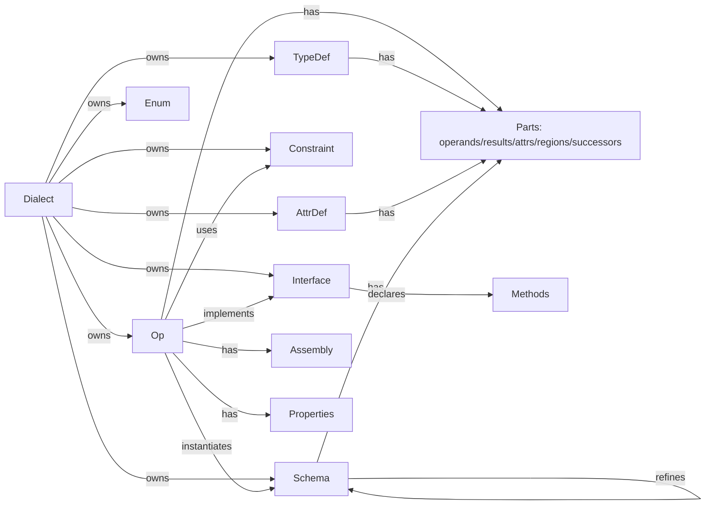

# 14. 方言定义的领域模型：先把"描述什么"想清楚

> 配套文件：[`sketch/arith.dialect`](sketch/arith.dialect)（96 行，一个方言的
> 领域描述样例）。
>
> 与 13 章的关系：13 章回答 **ODS 现在长什么样**（寄生在 TD 里的语义结构）；
> 本章回答 **如果只描述领域，应该长什么样**。两者不是同一件事的两种写法：
> 13 章是考古，本章是设计。
>
> 上一版 `design-first-v1/` 是先定文法、再凑样例的产物；本章判定它把
> codegen 的偶然结构（`Namespace` / `Class` / `Builders` / `Extra` / `Verify
> code`）当成了语言结构，因此归档；只保留其中的 format 子语言设计（v2 改名为 `Assembly`）。

## 0. 一句话定位

**方言定义语言的每个构造，都必须回答一个关于 IR 的问题；回答不了 IR 问题、
只回答"生成的 C++ 长什么样"的构造，不属于这门语言。**

这条标准会砍掉一大半 TD 语法。下面所有结论都从它推出。

## 1. 领域边界：定义 vs 生成

| 问题 | 属于领域定义 | 理由 |
| --- | --- | --- |
| 方言叫什么 | 是 | 决定 `arith.addi` 的文本身份 |
| op 有哪些部件 | 是 | operands / results / attributes / regions / successors |
| 部件的类型约束 | 是 | 决定一个 IR 是否合法 |
| op 怎么写出来 | 是 | assembly 是双向程序（parse + print） |
| op 的语义事实 | 是 | pure / commutative / terminator，优化与验证都要用 |
| 文档 | 是 | 会被 doc 生成器消费 |
| C++ 类名 | **否** | 命名约定；`AddIOp` 与 `addi` 无领域关系 |
| namespace / 头文件 | **否** | 由方言名与构建系统推导 |
| builder 签名 | **否** | 从结构生成，不是结构本身 |
| storage / segment 布局 | **否** | 从参数与可变元数生成 |
| 自定义 C++ 校验、额外声明 | **否** | 逃生舱；属于插件，不属于定义 |

判据只有一条：**把这个构造删掉，IR 的合法性、文本形式或语义会不会变？**
`Namespace "mlir::arith"` 删掉，`arith.addi` 仍然是 `arith.addi`——所以它出局。
`if overflow_flags { ... }` 删掉，`arith.addi` 的文本形式就变了——所以它留下。

这条判据同时解释了 13 章的一个现象：TD 的 `Op` 类有数十个字段
（`OpBase.td:345-478`），但真正对应领域问题的只有 `arguments` / `results` /
`regions` / `successors` / `traits` / `assemblyFormat` / `summary` 这几组，
其余大多是生成细节。

## 2. 实体：方言定义里到底有几种东西



| 实体 | 身份 | 回答的问题 |
| --- | --- | --- |
| `dialect` | 全局名字 | 这批定义属于哪个文本前缀 |
| `op` | dialect + mnemonic | IR 里的一类节点 |
| `type_def` | dialect + mnemonic | `!d.t` 形式的一类值 |
| `attr_def` | dialect + mnemonic | `#d.a` 形式的一类值 |
| `enum` | 定义内名字 | 一个封闭取值域 |
| `constraint` | 定义内名字 | 一个类型集合 |
| `schema` | 定义内名字 | 一组 op 的公共形状（复用机制） |
| `interface` | 名字 | 一组能力的方法契约 |
| `property` | 名字 | 一条可被依赖的语义事实 |

两点与 TD 不同，且都是领域层面的修正：

1. **`op` 的身份是助记符，不是 C++ 类名。** TD 写
   `def Arith_AddIOp : Arith_Op<"addi">`，一个定义里出现两个名字；领域里只有
   `arith.addi`。类名是生成器的输出，不是输入。
2. **`type_def` / `attr_def` 的身份也是助记符。** v1 里的 `Mnemonic "complex"`
   与声明名重复；声明名就是拼写。

## 3. 每个定义是三个正交投影

这是本章的核心结论。一个 op 定义同时描述三件事，三者互相约束，但**必须分开**：

| 投影 | 回答 | 载体 | 消费者 |
| --- | --- | --- | --- |
| **结构** structure | 一个实例由哪些部件组成 | operands / results / attributes / regions / successors | 验证器、builder、IR 数据结构 |
| **文本** text | 实例怎么写、怎么读 | assembly | parser / printer |
| **语义** semantics | 实例意味着什么、能依赖什么 | properties / invariants | 优化、分析、验证 |

TD 把三者压进同一个 `let` 命名空间：结构是 dag，文本是字符串，语义是
trait 名字列表。压在一起导致两个后果：

- **文本无法独立检查**：`assemblyFormat` 是 `STRING_LITERAL`，它的结构错误
  要到 `OpFormatGen` 才暴露（13 章 §8 第 8–20 条）。
- **语义无法分类**：`Traits<[Pure, Commutative, Terminator]>` 里三个名字是
  三种完全不同的东西（见 §5），但语法上同构。

领域模型要求三者各自有语法，并且有明确的**一致性法则**：

1. 文本必须覆盖结构中所有未省略的部件——否则打印会丢信息。
2. 每个可选文本片段必须有锚点——否则解析有歧义。
3. 结构上的约束必须被验证——否则非法 IR 能构造出来。
4. 语义事实必须与结构相容——`terminator` 必须位于 block 末尾、
   `isolated_from_above` 必须持有 region。

这四条法则正是 v1 的 `Format` 子语言想表达的东西，只是 v1 仍然把结构写成
`Operands(...)` 子句、把语义写成 `Traits[...]` 名字列表，没有把"三类事实"
显式化。

## 4. 结构：部件是一个有序映射，不是 dag

一个 op 的部件集合可以写成：

```
Parts = (name, kind, type_constraint, multiplicity, default)
```

| 字段 | 取值 | 说明 |
| --- | --- | --- |
| `kind` | operand / result / attribute / region / successor | 五种，领域内封闭 |
| `type_constraint` | 类型表达式 | 可以引用同 op 的其他部件 |
| `multiplicity` | one / optional / variadic / variadic_of_variadic | 元数 |
| `default` | 值表达式 | 仅 attribute 有 |

三个领域结论：

1. **"部件"只有五种。** TD 用 `arguments` 的 dag 把 operand / attribute /
   property 混在一个列表里，再靠元素类型区分（`Operator.cpp:646-666`）。
   领域模型不需要这种压缩：`Attrs` 与 `Operands` 是两个子句。
2. **顺序只在文本里有意义。** operand 的 SSA 顺序、result 的顺序影响文本与
   builder；attribute 是**集合**，顺序无意义。领域模型必须区分"有序"与
   "无序"——这正是 `attr-dict` 能在任意位置出现、且只出现一次的原因。
3. **元数是类型的一部分。** `variadic<T>` 不是 `T` 的列表简写：它改变
   验证、assembly（`operands` 整组指令）与 builder。领域模型把它放在类型层，
   而不是放在 trait 层（TD 的 `Variadic<...>` 也是类型层，这一点一致）。

## 5. 语义：把 trait 拆成四类

TD 的 `Traits<[...]>` 是一个同构列表，但里面的名字回答的是四类不同问题：

| 类别 | 例子 | 回答 | 谁消费 |
| --- | --- | --- | --- |
| **结构角色** | `Terminator`、`SingleBlock`、`IsolatedFromAbove`、`HasParent` | 它在 IR 树里怎么摆 | 验证器、region 规则 |
| **代数性质** | `Commutative`、`Idempotent`、`Elementwise` | 重写/规范化能依赖什么 | canonicalizer、pattern |
| **效应摘要** | `Pure`、`NoMemoryEffect`、`RecursivelySpeculatable` | 它读写什么、能否移动 | 分析、调度 |
| **能力/接口** | `VectorUnroll`、`CastOpInterface`、`InferIntRangeInterface` | 它支持哪些变换 | 变换 pass |

而且 `Pure` 本身不是原子事实：`SideEffectInterfaces.td:155` 里
`Pure = TraitList<[AlwaysSpeculatable, NoMemoryEffect]>`——它是两条效应的合取。
也就是说，TD 的 `Traits` 列表里既有原子事实，也有**派生事实**，语法上却看不出
差别。

领域模型的处理：

- `properties` 只收**原子语义事实**（`commutative`、`no_memory_effect`、
  `always_speculatable`、`terminator`、`single_block`…）。
- 派生事实（`pure`）由模型定义，不由使用者声明；或者允许写 `pure`，但它是
  `no_memory_effect & always_speculatable` 的语法糖，解析后展开。
- 接口（`CastOpInterface`）不是 property，而是 `implements` 关系。

**这条拆分有一个可验证的预测**：如果模型是对的，那么 TD 里那些"其实是约束"的
trait 应该能改写成约束表达式。§6 验证这个预测。

## 6. 约束：指称语义是类型集合

一个约束就是一个类型集合，加上一个可判定的成员测试。这给出一个干净的代数：

| 构造 | 指称 | TD 对应 |
| --- | --- | --- |
| `signless_integer`、`index`、`f32` | 原子集合 | `I32`、`Index`、`F32` |
| `A \| B` | 并集 | `AnyTypeOf<[A, B]>` |
| `A & B` | 交集 | `AllOfType<[A, B]>`（很少用） |
| `not A` | 补集 | `Neg<A>`（谓词层） |
| `any` | 全集 | `AnyType` |
| `type_of(x)` | 依赖约束：与部件 `x` 的类型相同 | `AllTypesMatch` / `SameOperandsAndResultType` |
| `variadic<T>` / `optional<T>` | 元数包装 | `Variadic<T>` / `Optional<T>` |

注意 `not A` 只能落到谓词层（`Neg<A>`）：ODS 的类型约束代数**对补集不封闭**。
这不是遗漏，而是可判定性使然——`TypeConstraint` 只回答"这个 type 是否属于集合"，
补集需要先有一个全类型域。领域模型若要保持代数封闭，就必须把类型域显式写出来；
否则 `not A` 只能作为谓词，而不是约束。

**预测的验证**：TD 里 `SameOperandsAndResultType`、`AllTypesMatch<["a","b"]>`、
`TypesMatchWith<...>` 三个 trait 做的是同一件事——约束部件之间的类型相等。
在领域模型里它们是 `type_of(x)`，不需要三个 trait，也不需要
`TypesMatchWith` 里那串 C++ 表达式（`OpBase.td:604,662`）。v1 的
`Traits [SameOperandsAndResultType]` 因此被 `Results (result: type_of(lhs))`
取代，样例见 `sketch/arith.dialect:19-20`。

同理，`$x` 在 `assemblyFormat` 里能出现，是因为它引用了一个已声明的部件；
这是**约束**（引用完整性），不是 trait。

## 7. assembly：一段双向程序，不是一个字符串

`assemblyFormat` 在 TD 里是 `STRING_LITERAL`，但它内部是一门独立的子语言
（13 章 §5 已给出 277 行的文法）。领域模型把它当一等构造：

```
Assembly := Element*
Element  := ref(name) | literal(text) | attr_dict | type_of(name)
          | if anchor { Assembly } [else { Assembly }]
          | custom<Hook>(args) | oilist<sep>(clauses) | struct { ... }
```

| 组合子 | 领域含义 | TD |
| --- | --- | --- |
| `name` | 引用一个部件 | `$name` |
| `","` | 固定文本（含标点） | `` `,` `` |
| `attr-dict` | "剩余属性"这个集合 | `attr-dict` |
| `type(x)` | 打印 `x` 的类型 | `type($x)` |
| `if x { A } else { B }` | 可选片段，`x` 是锚点 | `(A^ B)?` |
| `custom<F>(...)` | 交给成对的 parse/print 钩子 | `custom<F>` |
| `oilist` | 可重复、带分隔符的片段 | `oilist` |

两个设计结论：

1. **可选组必须有且只有一个锚点。** 打印时要知道"这个组要不要打"，只能看
   某个部件是否存在；解析时要知道"这个组从哪开始"，也只能看锚点。TD 用
   `^` 标注锚点（`FormatGen.cpp:342,376`），但锚点是**隐式**的——它藏在
   组内某个变量上。领域模型把它显式化成 `if x { ... }`：条件即锚点，读一遍
   就知道打印条件。
2. **`type(x)` 用圆括号，不用方括号。** v1 的 format 词法里 `(`/`)` 不是
   token，`type(...)` 根本无法解析，所以退成了 `type[...]`。领域语法里字面
   标点一律加引号（`"("`、`","`），结构性的圆括号只属于 `type(x)` 这类
   指令，因此不产生歧义，也更接近 MLIR 原写法。

## 8. schema：refinement，不是宏

`arith` 的 55 个 op 里，45 个（82%）可以归到 13 个公共形状下（整数二元、
浮点二元、比较、转换…），只有 10 个需要独立定义。这个比例说明 schema 是
领域里的一等复用机制，但它的语义是 **refinement**，不是文本替换：

| 子句 | 合并规则 | 理由 |
| --- | --- | --- |
| `Operands` / `Results` / `Attributes` / `Regions` / `Successors` | 按名字合并：同名覆盖，新名追加 | 部件是命名映射 |
| `Properties` | 并集 | 语义事实可叠加 |
| `Assembly` | 整体替换 | 文本片段无法按名字合并 |
| `doc` | 覆盖 | 单一值 |

对比 TD：`let arguments = ...` 是**整体替换**，派生类想收窄一个 operand 就必须
重写整个 dag；`Arguments<...>` mixin 则在类定义处一次性给出。领域模型按名字
合并，`cmpi` 只需写 `Operands (lhs: int_like)`，`rhs` 从 `Compare` 继承
（`sketch/arith.dialect:65-68`）。这是"领域模型比 TD 更准确"的一个具体证据：
TD 的替换语义是实现细节（`let` 是赋值），不是领域要求。

schema 也不需要助记符参数：op 的名字由 `op addi` 声明，schema 只提供部件。
TD 里 `class Arith_IntBinaryOp<string mnemonic, ...>` 的 `mnemonic` 参数是给
生成器用的（拼类名、拼 `getOperationName`），在领域里没有对应物。

## 9. 样例：`arith.dialect` 与它的 AST

`sketch/arith.dialect` 用 96 行描述了 arith 的一个子集：3 个约束、4 个 schema、
8 个 op，没有一行 C++。摘录：

```text
schema IntBinary {
  Operands (lhs: int_like, rhs: type_of(lhs))
  Results  (result: type_of(lhs))
  Properties [pure, elementwise]
  Assembly { lhs "," rhs attr-dict ":" type(result) }
}

schema IntBinaryWithOverflow extends IntBinary {
  Attributes (overflow_flags: OverflowFlags = none)
  Assembly {
    lhs "," rhs
    if overflow_flags { "overflow" overflow_flags }
    attr-dict ":" type(result)
  }
}

op addi from IntBinaryWithOverflow {
  doc "Integer addition."
  Properties [commutative]
}
```

### 9.1 表面 AST（as written）

```text
Dialect
├── name: arith
├── doc: "Arithmetic operations over integers, floats and index."
├── constraints
│   ├── int_like   = Union[Atom(signless_integer), Atom(index)]
│   ├── float_like = Union[Atom(f16), Atom(f32), Atom(f64), Atom(bf16)]
│   └── bool_like  = Atom(i1)
└── definitions
    ├── Schema IntBinary
    │   ├── Operands: [(lhs, int_like), (rhs, TypeOf(lhs))]
    │   ├── Results:  [(result, TypeOf(lhs))]
    │   ├── Properties: [pure, elementwise]
    │   └── Assembly: Seq[Ref(lhs), Lit(","), Ref(rhs), AttrDict,
    │                       Lit(":"), TypeOf(result)]
    ├── Schema IntBinaryWithOverflow
    │   ├── extends: IntBinary
    │   ├── Attributes: [(overflow_flags, OverflowFlags, default=none)]
    │   └── Assembly: Seq[Ref(lhs), Lit(","), Ref(rhs),
    │                       Opt(anchor=overflow_flags,
    │                           then=Seq[Lit("overflow"), Ref(overflow_flags)]),
    │                       AttrDict, Lit(":"), TypeOf(result)]
    └── Op addi
        ├── from: IntBinaryWithOverflow
        └── Properties: [commutative]
```

### 9.2 解析后的模型（refinement 已展开）

```text
Op arith.addi
├── operands
│   ├── lhs: int_like
│   └── rhs: TypeOf(lhs)
├── results
│   └── result: TypeOf(lhs)
├── attributes
│   └── overflow_flags: OverflowFlags = none
├── properties: [pure, elementwise, commutative]
├── assembly: Seq[Ref(lhs), Lit(","), Ref(rhs),
│                 Opt(anchor=overflow_flags, ...), AttrDict,
│                 Lit(":"), TypeOf(result)]
└── doc: "Integer addition."
```

两层 AST 的存在本身是领域要求：**schema 实例化是语义动作**（合并、覆盖、
并集），必须先有表面结构，才有解析后的模型。TD 的语法层没有这个区分：
`class` 实例化发生在 `Record` 构造时，"实例化前的 def"与"实例化后的字段"
在语法上是同一层，所以无法对两者分别做检查。

## 10. 这个模型解释了 ODS 的哪些现象

一个好的领域模型应该能**解释**现有实现，而不只是替换它。四条检验：

| 现象 | 领域模型的解释 |
| --- | --- |
| 为什么 `assemblyFormat` 的可选组必须有锚点 | 打印必须能判定"组是否存在"；锚点是唯一判据。v1 把它写成 `^` 是隐式的，模型要求显式 `if` |
| 为什么同时存在 `AnyTypeOf` 和 `And` 两套组合子 | 前者是类型集合运算（约束层），后者是谓词运算（可判定性层）；指称对象不同，不能合并 |
| 为什么 `hasVerifier` 是布尔而不是字符串 | 验证是定义的**属性**（有/无），验证体是代码——属于插件，不属于领域语言 |
| 为什么 `SameOperandsAndResultType` 是 trait 却像约束 | 它是"部件类型相等"的约束，被 TD 的实现方式挤进了 trait 列表；领域模型把它归位（§6） |

反过来，模型也解释了 v1 为什么会跑偏：v1 把 `Namespace` / `Class` / `Builders`
当成了定义的一部分，因为它们**在 TD 文件里确实存在**。但"在文件里存在"不等于
"在领域里存在"——这正是 13 章 §1 说的"ODS 寄生在 TD 语法里"的另一面：
宿主的语法会伪装成领域的语法。

## 11. v1 的逐项判决

| v1 构造 | 领域判定 | 处理 |
| --- | --- | --- |
| `Namespace "mlir::arith"` | codegen 泄漏 | 删除；文本前缀由 `dialect arith` 推导 |
| `Class "ArithDialect"` | codegen 泄漏 | 删除 |
| `op AddIOp "addi"` | 类名不是身份 | 改为 `op addi`；`arith.addi` 由 dialect + 名字合成 |
| `Mnemonic "complex"` | 与声明名重复 | 删除 |
| `Builders [ Build(...) code { ... } ]` | API 生成 | 删除；builder 由结构生成 |
| `Extra code { ... }` | C++ 逃生舱 | 删除；需要时用插件 |
| `Verify code { ... }` | 命令式检查 | 改为声明式 `Invariants`；复杂检查交给插件 |
| `Format Custom` | 文本形式缺失 | 删除；省略 `Assembly` 即"只有 generic form" |
| `opt_semi`（分号可选） | 语言自身的歧义 | 删除；统一约定：子句以 `;` 结尾，以 `}` 结尾的块状子句除外 |
| `format_anchor` 允许 `operands`/`results` | 正确，但理由没说清 | 保留；整组指令本身就是锚点（§7） |
| `type[...]` 方括号 | v1 词法不支持裸括号 | 改为 `type(x)`；结构性括号只属于指令，字面括号加引号 |
| `Traits [SameOperandsAndResultType]` | 约束误记为 trait | 改为 `type_of(lhs)` |

## 12. 下一步：语料优先

本章只完成了"定义语言该描述什么"。语法还没有定，而且**不应该先定**。下一步按
语料优先的方法走：

1. **写源程序**：用 `sketch/arith.dialect` 的写法，把 arith / func / scf / cf
   完整写成四个 `.dialect` 文件（先不管能否解析）。
2. **归纳文法**：从语料里数出词法单元、声明形态、子句×实体的共现矩阵、
   `Assembly` 组合子的使用频次；每条产生式必须至少有一个语料见证。
3. **机械核对**：bison 0 冲突；四个文件全部 `parse OK`；反向审计每条产生式
   是否被语料使用（dead rule audit）。
4. **只在这时**才写 `dialect-grammar.y`，并保留"产生式 ↔ 语料行号"的对照表。

先写程序、后写文法，是因为文法一旦先定，就会不自觉地按文法去裁剪语料——
v1 的 `examples/*.mdl` 正是这样被裁剪出来的：它们都能解析，但都没有回答
"这个方言在领域里是什么"。

## 13. 结论

1. **方言定义语言描述三件事：结构、文本、语义。** 三者正交，各有语法，
   靠四条一致性法则约束。TD 把它们压进 `let` 命名空间，是宿主语法的偶然。
2. **身份是助记符，不是类名。** `arith.addi` 只需要一个名字；C++ 名是生成的
   输出。删掉 `Namespace` / `Class` 之后，定义语言只剩下领域问题。
3. **trait 是四类东西的集合**（结构角色、代数性质、效应摘要、能力），
   不是一种东西。`Pure` 甚至是两条效应的合取。领域模型要求拆分。
4. **约束的指称是类型集合。** 部件间的类型相等是约束（`type_of(x)`），
   不是 trait；这一条把 `SameOperandsAndResultType` / `AllTypesMatch` /
   `TypesMatchWith` 三个特殊机制收成一个构造。
5. **assembly 是双向程序。** 可选组必须显式锚定；`if x { ... }` 比
   `(...^...)?` 更接近领域事实，也更容易检查。
6. **schema 是 refinement。** 按名字合并部件、并集属性、整体替换文本。
   TD 的整体替换是赋值语义的副作用，不是领域要求。
